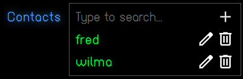

# jopr-contacts-select

`jopr-contacts-select` is a custom Web Component that renders a searchable multi-select contact sublist. It integrates with `<de-search-multi-select>` to display an `<h2>Contacts</h2>` section header, an auto-complete search combobox with an options dropdown, and rendered entry cards for chosen contacts with edit and delete action menus.

It is designed for embedding inside parent forms (such as job details) to associate contacts with a record.



## Usage

### HTML
```html
<jopr-contacts-select id="job_contacts" name="contacts"></jopr-contacts-select>
```

### JavaScript Integration

```javascript
const contactsSelect = document.getElementById("job_contacts");

// 1. Populate available searchable options
contactsSelect.items = [
  {
    id: 1,
    name: "Jonathan Rhodes",
    email: "jonathan@example.com",
    agency: { name: "Hays Recruitment" }
  },
  {
    id: 2,
    name: "Debbie Teakle",
    email: "debbie@example.com",
    agency: { name: "Michael Page" }
  }
];

// 2. Set currently selected contacts
contactsSelect.value = [
  { id: 1, name: "Jonathan Rhodes", email: "jonathan@example.com" }
];

// 3. Add or remove contacts dynamically
contactsSelect.Add({ id: 3, name: "Jun Ling", email: "jun@example.com" });
contactsSelect.Remove(1);

// 4. Retrieve current selection
const selected = contactsSelect.value;
console.log("Selected contacts:", selected);

// 5. Listen for Header Actions
contactsSelect.addEventListener("add", () => {
  console.log("Add contact button clicked: Open create contact dialog");
});

// 6. Listen for Item Menu Actions (bubbled from de-toolbar-menu)
contactsSelect.addEventListener("edit", (event) => {
  const contact = event.detail;
  console.log("Edit requested for contact:", contact);
});

contactsSelect.addEventListener("delete", (event) => {
  const contact = event.detail;
  console.log("Delete requested for contact:", contact);
});
```

## Fields & Properties

* **`value`**: *Array<Object>*. Gets or sets the array of currently selected contact records.
* **`items`**: *Array<Object>|null*. Gets or sets the available contact options array provided to the internal `<de-search-multi-select>` combobox. Automatically normalizes records with `title` and `value` properties.
* **`contacts_search_select`**: *DeSearchMultiSelect*. DOM reference to the internal `<de-search-multi-select>` element (`cid="contacts_search_select"`).
* **`contacts_list`**: *Object*. Compatibility adapter exposing `Add(item)`, `Remove(item)`, and `value` getter/setter.

## Events

* **`add`**: Dispatched when the user clicks the add contact button in the search combobox.
  * Bubbles: `true`.
* **`edit`**: Bubbles up from an item's `de-toolbar-menu` when the edit action is clicked. `event.detail` contains the contact object.
  * Bubbles: `true`.
* **`delete`**: Bubbles up from an item's `de-toolbar-menu` when the delete action is clicked. `event.detail` contains the contact object.
  * Bubbles: `true`.

## Methods

* **`Add(obj)`**: Appends a new contact object to the selected list and adds it to available items if not already present.
* **`Remove(obj_id)`**: Removes a contact object from the selected list by its ID or value.
* **`Render()`**: Renders the sublist layout containing the `<h2>Contacts</h2>` header and `<de-search-multi-select>` component.
* **`Extend_To_Item(contact)`**: Static helper method that normalizes a contact object to have `value` and `title` properties.
* **`Extend_To_Items(contacts)`**: Static helper method that normalizes an array of contact objects.
* **`Get_Contact_Name(contact)`**: Static helper method that returns the display name or fallback for a contact.