# JOPR — Progressive Web App Architecture & Design Guide

> **Document Status:** Draft / Scaffold  
> **Last Updated:** October 2026  
> **Target Application:** `public/app/jopr/`

---

## 1. System Overview & Philosophy

### 1.1 Mission & Vision
JOPR (Job Optimization & Application Tracker) is a privacy-first, local-first Progressive Web App designed to empower job seekers in customizing and optimizing their resumes, cover letters, and application tracking against automated applicant tracking systems (ATS) and recruitment pipelines.

### 1.2 Core Architectural Principles
- **Zero Signup & Local-First:** All personal information, career histories, application statuses, and customized documents live locally in the user's browser using IndexedDB. No mandatory external accounts or third-party databases.
- **Pure Web Standards (Frameworkless):** Built with Vanilla JavaScript (ES6 Modules), standard HTML5, and Vanilla CSS. No heavy frontend libraries or build/transpilation steps required.
- **Web Components:** Reusable, encapsulated UI elements built as native Custom Elements extending `HTMLElement`.
- **Progressive Web App (PWA):** Fully offline-capable, installable to desktop/mobile home screens, and managed via Service Workers.
- **Modular AI Acceleration:** Client-side orchestration of generative AI workflows for document extraction, role matching, and resume tailoring using structured schemas.

---

## 2. Directory & File Organization

The application is organized according to the Dulce Engineering PWA architectural standard:

```text
public/app/jopr/
├── index.html                  # Main Job Tracker dashboard
├── landing.html                # Public promotional / landing page
├── manifest.json               # Web App Manifest (PWA metadata)
├── README.md                   # Application overview and feature roadmap
├── types.d.ts                  # JSDoc TypeScript definitions
├── component/                  # Custom Web Components (de-*, jopr-*)
│   ├── de-clock-2/
│   ├── de-contact-details/
│   ├── de-contact-form/
│   ├── de-contact-list/
│   ├── de-contact-select/
│   ├── de-edit-text/
│   ├── de-field/
│   ├── de-filter/
│   ├── de-info/
│   ├── de-job-details/
│   ├── de-project-list/
│   ├── de-search-select/
│   ├── de-select-status/
│   ├── de-toolbar-menu/
│   ├── jopr-chart/
│   └── jopr-header/
├── db/                         # Database schema definitions and seed data
│   ├── schema.js               # IndexedDB stores, keys, and indexes
│   └── job-trak-data.json      # Sample / export data snapshots
├── doc/                        # Technical documentation, guides, and specifications
│   ├── architecture.md         # (This document) PWA architecture specification
│   ├── bring-your-own-storage.md
│   ├── payment-strategies.md
│   ├── testing-strategy.md
│   └── token-tracking.md
├── font/                       # Embedded web fonts
├── image/                      # Application icons, UI SVGs, and graphics
├── lib/                        # Core application business logic and context
│   ├── AI.js                   # Generative AI workflows & prompt engineering
│   ├── Agency.js               # Recruitment agency domain model
│   ├── config.js               # Environment and AI model configuration
│   ├── Contact.js              # Professional contacts domain model
│   ├── ctx.js                  # Central context and state coordination
│   ├── Db.js                   # IndexedDB wrapper and query manager
│   ├── Job.js                  # Job record domain model & operations
│   ├── Profile.js              # User profile & work history domain model
│   ├── Project.js              # Portfolio project domain model
│   ├── service-worker.js       # PWA offline cache and network routing
│   ├── Template.js             # HTML templating and document rendering helpers
│   └── Utils.js                # General utility routines
├── page/                       # Secondary application pages
│   ├── cheatsheet.html         # Technical interview cheatsheet
│   ├── gen-cl.html             # Cover letter generator
│   ├── gen-cv-1.html           # CV generator (Step 1)
│   ├── gen-cv-2.html           # CV generator (Step 2 - Tailoring)
│   ├── gen-cv.js               # Controller logic for CV generation
│   ├── index.js                # Controller logic for main dashboard
│   ├── profiles.html           # Profile and career history editor
│   ├── profiles.js             # Controller logic for profile editing
│   └── template.html           # Common page shell template
└── style/                      # Responsive CSS stylesheets
    └── large.css               # Wide-screen desktop layout rules
```

---

## 3. PWA & Offline Strategy

### 3.1 Service Worker (`lib/service-worker.js`)
- **Lifecycle & Activation:**
  - *TODO: Document install, activate, and update lifecycle hooks.*
- **Caching Strategy:**
  - *TODO: Document Cache-First vs. Network-First policies for static assets, fonts, and application pages.*
- **Offline Resilience:**
  - *TODO: Document behavior when executing without active internet connectivity.*

### 3.2 Manifest Configuration (`manifest.json`)
- **Metadata & Capabilities:**
  - Name, short name, start URL, theme colors, and display mode (`standalone`).
  - Icon sets and responsive resolution definitions.

---

## 4. Data Layer & Storage Architecture

### 4.1 Storage Engine (`lib/Db.js` & `db/schema.js`)
- JOPR uses browser **IndexedDB** as its primary persistent data store (`JobTrakDB`, version 8).
- **Object Stores:**
  - `jobs`: Tracked job applications, statuses, notes, and generated CV/CL links.
  - `profiles`: User personal profiles, contact details, summaries, and global skills.
  - `career`: Complete historical employment records (role titles, tech, dates, accomplishments).
  - `education`: Academic history, degrees, certifications, and institutions.
  - `projects`: Portfolio projects, case studies, and code repositories.
  - `contacts`: Recruiters, hiring managers, and professional references.
  - `agencies`: Recruitment agencies and employer companies.
  - `attachments`: Uploaded binary files / documents attached to specific jobs.
  - `action_logs`: Chronological log entries and notes tracking job interactions.

### 4.2 Database Entity-Relationship (ER) Diagram

The following diagram illustrates the entity structures and relational associations defined in [`db/schema.js`](file:///c:/projects/company/public/app/jopr/db/schema.js):



#### Relational Cardinality Notes
- **Profile Hierarchy:** A `profile` acts as the root for career history and education (`1:N` to `career` and `education` via `profile_id`).
- **Agency & Contacts:** An `agency` can employ multiple `contacts` (`1:N` via `agency_id`).
- **Job Associations:** A `job` record can optionally link to an `agency` (`agency_id`) and a specific `contact` (`contact_id`).
- **Job Activity:** Each `job` can possess multiple binary `attachments` (`job_id`) and chronological `action_logs` (`job_id`).
- **Standalone Entities:** `projects` records are maintained independently as reusable portfolio assets.

### 4.3 Schema Versioning & Migrations
- Schema upgrades are managed via `schema.js` and `Db.prototype.On_Upgrade_Needed`.
- *TODO: Document migration guidelines when adding new columns or foreign keys.*

### 4.4 Context Layer (`lib/ctx.js`)
- Acts as the central state coordinator passed to pages and components.
- Exposes domain controllers (`ctx.Job`, `ctx.Profile`, `ctx.Contact`, etc.).
- Decouples UI components from direct database access.

### 4.5 Data Portability & Backup
- **Import / Export:** Full JSON backup and restore capability allowing device-to-device state synchronization without a remote server.
- *TODO: Document future Bring-Your-Own-Storage (BYOS) cloud sync options.*

---

## 5. Component Model (Native Web Components)

### 5.1 Standards & Registration
- UI controls are implemented as native Custom Elements extending `HTMLElement`.
- Component class naming: `PascalCase` with `De` prefix (e.g., `DeJobDetails`, `DeField`).
- Custom tag naming: Hyphenated lowercase with `de-` prefix (e.g., `de-job-details`, `de-field`).
- Registration via `Utils.Register_Element(DeClassName)` from `public/lib/Utils.js`.

### 5.2 Internal DOM ID Shortcuts (`cid`)
- Internal element references use `cid="..."` attributes in HTML templates.
- Resolved during initialization using `Utils.Set_Id_Shortcuts(this, this, "cid")` to bind elements directly to instance properties (e.g., `this.title_elem`).

### 5.3 Component Taxonomy
- **Input & Editing Primitives:**
  - `de-field`: Standardized form field with label, validation, and layout bindings.
  - `de-edit-text`: In-place editable text element supporting modal or expanded editor views.
  - `de-search-select`: Searchable auto-complete dropdown selector.
  - `de-select-status`: Job status badge and picker control.
  - `de-filter`: List filtering and sorting bar.
- **Domain Widgets:**
  - `de-job-details`: Comprehensive view and edit panel for job application records.
  - `de-contact-form`, `de-contact-details`, `de-contact-list`, `de-contact-select`: Contact relationship management widgets.
  - `de-project-list`: Portfolio project manager.
- **Application Shell & Feedback:**
  - `jopr-header`: Global branding, active clock, and top-level navigation.
  - `jopr-chart`: Live SVG/Canvas metrics chart visualizing market trends and application stats.
  - `de-toolbar-menu`: Action and page navigation toolbar.
  - `de-info`: Toast/notification system for user actions and background task progress.

---

## 6. Page Routing & View Controllers

JOPR utilizes a multi-page PWA architecture with standalone HTML documents and paired ES Module controllers:

### 6.1 Job Tracker Dashboard (`index.html` / `page/index.js`)
- Primary landing interface after onboarding.
- Job application card list grouped by status (Applied, Interviewing, Offer, Archived).
- Real-time job filtering, sorting, and statistical metrics.

### 6.2 Profile & Career Manager (`page/profiles.html` / `page/profiles.js`)
- Central hub for managing the applicant's master employment history.
- Personal summary, skills inventory, educational background, and verified work history nodes.

### 6.3 Tailored Document Generation
- **CV Tailoring Engine (`page/gen-cv-1.html`, `page/gen-cv-2.html` / `page/gen-cv.js`):**
  - Step 1: Target job intake and automatic parsing.
  - Step 2: Role alignment, title optimization, and achievement rewriting.
- **Cover Letter Engine (`page/gen-cl.html`):**
  - Synthesizes job description pain points with applicant strengths to produce a tailored letter.

### 6.4 Knowledge Base & Cheatsheets (`page/cheatsheet.html`)
- Hierarchical technical interview preparation system covering system design, .NET/C#, architecture questions, and behavioral frameworks.

---

## 7. AI Engine & Prompt Pipeline (`lib/AI.js`)

### 7.1 Architecture & SDK
- Uses Google GenAI / Firebase AI SDK to perform client-driven generative workflows.
- Relies strictly on typed structured output schemas (`Schema.object`, `Schema.array`) to guarantee deterministic responses.

### 7.2 Core AI Pipelines
1. **CV Ingestion & Extraction (`Extract_CV`):**
   - Ingests raw resume text or document upload to extract profile information, education records, and employment timelines.
2. **Target Job Parsing:**
   - Extracts key requirements, desired tech stack, and role responsibilities from unformatted job advertisements.
3. **Best Job Selector (`Select_Best_Jobs`):**
   - Matches a prospective job's requirements against the full career timeline to select the most strategic 4–6 positions.
4. **Role Title Alignment (`Generate_Job_Title`):**
   - Suggests context-appropriate job titles that match the target role's seniority and tech stack while preserving historical integrity.
5. **Job Description & Achievement Rewriter (`Generate_Job_Description`):**
   - Re-frames historical responsibilities and accomplishments to mirror the prospective role's vocabulary.
   - Strictly omits repeating the role title inside summaries/bullets to support independent user edits.
6. **Cover Letter Generator (`Generate_Cover_Letter`):**
   - Produces a compelling narrative addressing the hiring organization's specific challenges.

---

## 8. Styling & Visual Design System

### 8.1 CSS Architecture
- Component-scoped CSS files located adjacent to component implementations.
- Global variables and reset styles defined in `style/` and `page/` stylesheets.
- CSS Custom Properties for theme tokens (`--primary-color`, `--bg-card`, `--text-main`, etc.).

### 8.2 Responsive Layouts
- Mobile-first default layouts utilizing CSS Flexbox and Grid.
- Desktop enhancements applied via `style/large.css` (`@media (min-width: 768px)` and wider).

---

## 9. Security, Privacy & Integrity

- **Client-Side Data Boundary:** No user career data or contact information leaves the client browser except when sent directly to the configured AI API endpoint for user-initiated generation tasks.
- **API Key Management:** Supports user-supplied API keys stored in local browser storage or authenticated Firebase Cloud Functions proxy.
- **Input Sanitization:** User-provided HTML and Markdown inputs are sanitized before rendering to prevent XSS vulnerabilities.

---

## 10. Future Architectural Roadmap

- [ ] **Cloud Sync & Bring-Your-Own-Storage (BYOS):** Optional Google Drive, Dropbox, or private S3 backup synchronization.
- [ ] **Backend Cloud Functions Proxy:** Offload AI requests to secure Firebase Cloud Functions with rate limiting and quota management.
- [ ] **Automated Testing Suite:** Expanded Playwright end-to-end tests for all PWA workflows.
- [ ] **Document Export Options:** Direct PDF and DOCX export rendering natively on the client.
