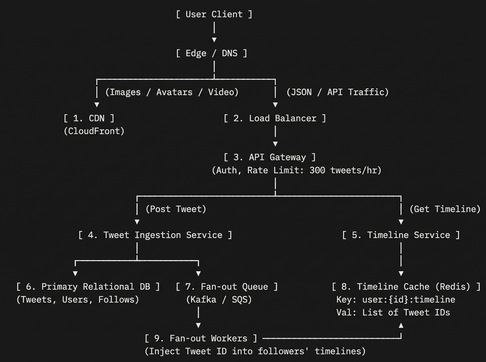

Here is how the generic Master Skeleton directly maps to the classic "Design Twitter / X" prompt.

A Twitter clone boils down to two core operations: **Post a Tweet (Write)** and **View Home Timeline (Read)**. Because reads outnumber writes by 100:1 or more, the architecture is tailored around fast timeline delivery.

---

### The Architecture Diagram

---

### Mapping the 10 Universal Suspects to Twitter

| Component | Standard Role | Twitter-Specific Implementation |
| --- | --- | --- |
| **1. CDN** | Edge cache | Serves user avatars, tweet media (PNG, JPEG, MP4 chunks), and pre-rendered public tweets. |
| **2. Load Balancer** | Traffic distribution | Terminates TLS, round-robins traffic across stateless API pods. |
| **3. API Gateway** | Auth & Perimeter guard | Authenticates JWT/session, enforces rate limits (e.g., standard accounts capped at 100 tweets/hour to block spambots). |
| **4. Tweet Service** | Core write compute | Validates 280-char limit, assigns a 64-bit globally unique `tweet_id` (Snowflake ID), writes to DB, and emits an event. |
| **5. Timeline Service** | Core read compute | Fetches the user's pre-computed timeline from Redis in sub-10ms. If a cache miss occurs, falls back to querying the DB. |
| **6. Primary DB** | Source of truth | Relational DB (Postgres/MySQL) or partitioned NoSQL (DynamoDB/Cassandra). Stores tweets, user profiles, and social follow graphs. |
| **7. Message Queue** | Asynchronous decoupler | Kafka topic `tweet-created`. Decouples saving the tweet from the expensive process of notifying followers. |
| **8. Fan-out Workers** | Background compute | Pulls `tweet-created` events, queries the follow graph for the author's followers, and pushes the new `tweet_id` into each follower's Redis timeline. |
| **9. Timeline Cache** | Read acceleration | In-memory Redis cluster. Every active user has a Redis `List` or `ZSet` storing their top 800 recent tweet IDs. |
| **10. Media Store** | Blob storage | AWS S3 for raw media uploads (not drawn above, but referenced: clients upload media to S3 via pre-signed URLs; tweet contains the S3 URL). |

---

### The Interviewer's Favorite Deep-Dive: Fan-Out

In a Twitter interview, the interviewer almost always pushes on one specific bottleneck: **The Fan-out Strategy**.

#### 1. Fan-out-on-Write (Push Model)

* **How it works:** When user `A` posts a tweet, background workers look up `A`'s 500 followers and append the tweet ID to all 500 follower timelines in Redis.
* **Pro:** Timeline reads are instant ($O(1)$ lookup from Redis).
* **Con:** Huge write amplification if `A` has 50 million followers (e.g., a celebrity). Generating 50 million Redis writes freezes the queue.

#### 2. Fan-out-on-Read (Pull Model)

* **How it works:** When user `B` opens their app, the system dynamically queries the DB: `SELECT tweet_id FROM tweets WHERE user_id IN (following_list) ORDER BY created_at DESC LIMIT 20`.
* **Pro:** Zero write amplification when a celebrity posts.
* **Con:** Slow reads. Running multi-key joins and sorting millions of rows across hundreds of followed accounts kills database latency at scale.

#### 3. The Hybrid Approach (The Expected Senior Answer)

You explain to the interviewer that you use a **hybrid threshold**:

* **Standard Users (< 25,000 followers):** Use **Fan-out-on-Write**. Push tweets into followers' Redis caches asynchronously via the queue.
* **Celebrities / High-Follower Accounts (> 25,000 followers):** Do **NOT** fan out to followers. Instead, write their tweets only to their personal tweet store.
* **Read Aggregation:** When a user opens their timeline:
1. Fetch their pre-computed Redis timeline (contains tweets from normal friends).
2. Fetch the latest tweets from the handful of celebrities they follow.
3. Merge and sort the two lists in memory at the app tier before returning JSON to the client.

---

### How to Deliver This in Under 6 Minutes

1. **Drop the Skeleton:** Draw `Client -> LB -> Gateway -> Service -> DB` and add the `Redis` cache and `Kafka` queue.
2. **Define the Write Path:** *"The user posts a tweet. The Tweet Ingestion Service writes it to the database, then drops a message on Kafka and immediately responds `201 Created` to keep user latency under 50ms."*
3. **Define the Async Path:** *"Workers pull the message from Kafka. They fetch the author's followers and push the `tweet_id` into each follower's Redis timeline list using an `LPUSH` capped at 800 items."*
4. **Define the Read Path:** *"When a user views their feed, the Timeline Service hits Redis, runs an `LRANGE 0 20` to get the latest tweet IDs, hydra-fetches tweet metadata from cache/DB, and returns the feed."*
5. **Address the Celebrity Trade-off:** Mention the hybrid fan-out model before they even ask. This shows you already know where the template meets its physical limits.